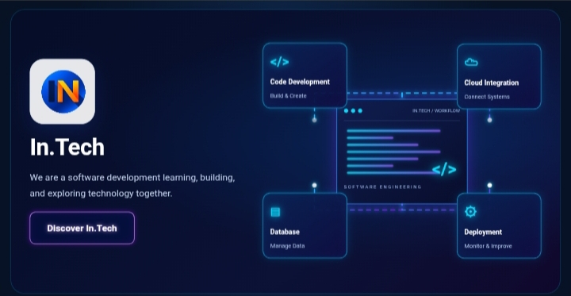

<p align="center">
  
</p>

> We are a software development learning, building, and exploring technology together.


# In.Tech

In.Tech is a self-hosted web application for company management and software engineering learning. It combines a web-based interface, a Python and Flask backend, and a local SQLite database.

Each installation operates independently with its own administrator credentials, session secret, and database.

## Project Goals

- Provide a practical environment for learning software engineering.
- Demonstrate how frontend and backend components work together.
- Practice authentication, database operations, and application security.
- Make the application available for independent self-hosted installations.

## Features

### Application
- Responsive web interface.
- Administrator login and logout.
- Session-based authentication.
- Dashboard with application overview and status information.
- Contact message management.
- User management with CRUD operations.
- Learning content management with CRUD operations.
- Four software engineering learning sections.

### Security
- Password hashing with Werkzeug.
- CSRF protection for state-changing requests.
- Input validation.
- Secure session cookie options.
- Locally generated Flask session secret.
- HTTP 404 and 500 error handlers.

### Learning Sections
- Web Development
- Backend Development
- Database Management
- Software Engineering

## Technology Stack

| Technology | Purpose |
|---|---|
| Python 3.14 | Development environment |
| Flask 3.1.3 | Web application framework |
| Werkzeug 3.1.9 | Authentication and password hashing utilities |
| SQLite | Local database |
| HTML | Page structure |
| CSS | Interface styling |
| JavaScript | Frontend interactions |

## Project Structure

```text
devcompany/
├── app.py
├── company.py
├── database.py
├── requirements.txt
├── .env.example
├── .gitignore
├── README.md
├── LICENSE
├── CONTRIBUTING.md
├── SECURITY.md
├── CODE_OF_CONDUCT.md
├── static/
│   ├── css/
│   ├── images/
│   └── js/
├── templates/
│   ├── backend_development.html
│   ├── dashboard.html
│   ├── database_management.html
│   ├── index.html
│   ├── login.html
│   ├── software_engineering.html
│   └── web_development.html
└── instance/
    ├── devcompany.db
    └── secret_key
```

The `instance/` directory is created automatically when the application initializes. It stores installation-specific data and is excluded from version control.

The database and session secret must remain private and must not be included in a public repository.

## Installation

### Requirements

- Python 3.14 or a compatible supported Python version.
- pip.
- Git.
- A terminal environment.

### 1. Clone the Repository

```bash
git clone YOUR_REPOSITORY_URL
cd devcompany
```

Replace `YOUR_REPOSITORY_URL` with the repository URL after the project has been published.

### 2. Create a Virtual Environment

```bash
python -m venv .venv
source .venv/bin/activate
```

### 3. Install Dependencies

```bash
pip install -r requirements.txt
```

### 4. Configure Administrator Credentials

Create a local environment configuration file:

```bash
cp .env.example .env
```

Edit `.env` and provide your own administrator username and password.

```env
DEVCOMPANY_USERNAME=your_admin_username
DEVCOMPANY_PASSWORD=replace-with-your-own-password
DEVCOMPANY_COOKIE_SECURE=0
```

The administrator password must contain at least 12 characters.

Configure the session cookie setting:

- `DEVCOMPANY_COOKIE_SECURE=0` for local HTTP development.
- `DEVCOMPANY_COOKIE_SECURE=1` when the application is accessed through HTTPS.

Load the environment variables in your terminal:

```bash
set -a
source .env
set +a
```

The application reads configuration from environment variables. It does not automatically load the `.env` file.

Never publish your real `.env` file or share administrator credentials.

### 5. Run the Application

```bash
python app.py
```

Open the application in your browser:

```text
http://127.0.0.1:5000/
```

The application initializes its local SQLite database and session secret when required.

Each installation maintains its own administrator configuration, database, and session secret.

## Application Routes

| Method | Route | Description |
|---|---|---|
| GET | `/` | Home page |
| GET, POST | `/login` | Administrator login |
| POST | `/logout` | Administrator logout |
| GET | `/dashboard` | Administrator dashboard |
| GET | `/api/dashboard-overview` | Dashboard overview data |
| GET | `/api/status` | Application status |
| GET, POST | `/contact` | Contact page and message submission |
| GET | `/api/messages` | Retrieve contact messages |
| GET | `/api/messages/<message_id>` | Retrieve a specific message |
| DELETE | `/api/messages/<message_id>` | Delete a contact message |
| GET | `/api/users` | Retrieve users |
| POST | `/api/users` | Create a user |
| PUT | `/api/users/<user_id>` | Update a user |
| DELETE | `/api/users/<user_id>` | Delete a user |
| GET | `/api/learning-contents` | Retrieve learning content |
| POST | `/api/learning-contents` | Create learning content |
| GET | `/api/learning-contents/<content_id>` | Retrieve specific learning content |
| PUT | `/api/learning-contents/<content_id>` | Update learning content |
| DELETE | `/api/learning-contents/<content_id>` | Delete learning content |
| GET | `/learn/web-development` | Web Development learning page |
| GET | `/learn/backend-development` | Backend Development learning page |
| GET | `/learn/database-management` | Database Management learning page |
| GET | `/learn/software-engineering` | Software Engineering learning page |

## Security

- Administrator credentials are provided through environment variables.
- Password verification uses Werkzeug password hashing.
- The Flask session secret is generated locally and stored in `instance/secret_key`.
- The session secret file is assigned restrictive file permissions.
- Session cookies use `HttpOnly` and `SameSite=Lax`.
- The `Secure` cookie option can be enabled when HTTPS is configured.
- State-changing requests are protected by CSRF validation.
- CSRF tokens can be supplied through the `X-CSRF-Token` header or the `csrf_token` form field.
- Private environment files, database files, and the `instance/` directory are excluded through `.gitignore`.

### Deployment Notes

The included application startup configuration binds to `127.0.0.1` and is intended for local access.

For network or production deployment, configure an appropriate production WSGI server and HTTPS. Review the deployment configuration before making the application accessible to other devices or users.

Every installation must use its own administrator credentials, session secret, and database.

Never publish:
- `.env`
- `instance/`
- Private database files
- Session secret files
- Administrator credentials

## Project Documentation

- [MIT License](LICENSE)
- [Contribution Guidelines](CONTRIBUTING.md)
- [Security Policy](SECURITY.md)
- [Code of Conduct](CODE_OF_CONDUCT.md)

## Learning Philosophy

Build, understand, share, and improve.

In.Tech is developed as a practical software engineering project. Its documentation and implementation are intended to help users understand, install, operate, and improve their own independent installations.
